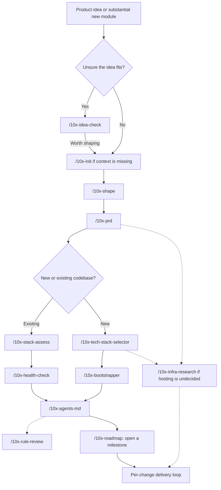
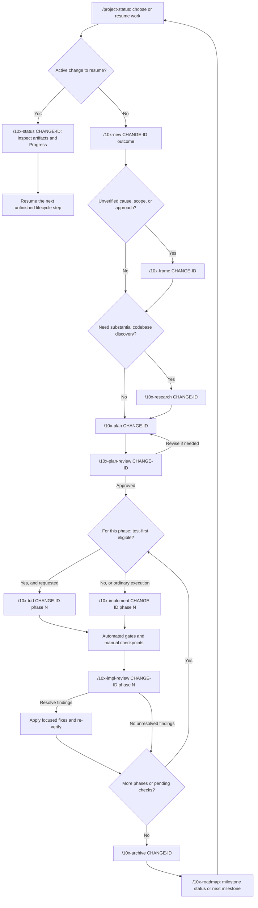
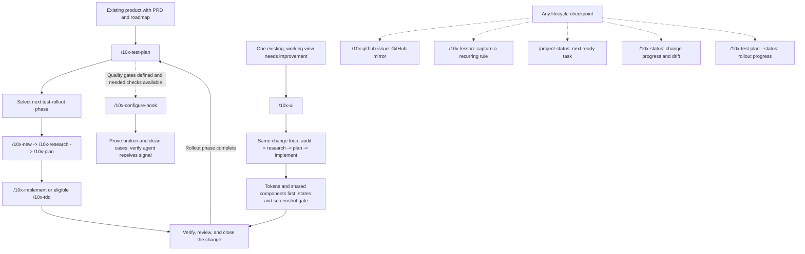

# Project Skills Workflow

This guide maps all **28 project-local skills** in [`.github/skills/`](../../.github/skills/). It describes the installed skill definitions, not a requirement to run every skill on every task. Editor/plugin skills installed outside this repository are not part of this map.

**For this existing project, start with `/project-status`, then resume the current change. Do not restart project setup for each feature.**

## How to use this guide

- Run `/skill-name arguments` in **Copilot Chat**, not in PowerShell.
- Replace `<change-id>` with one kebab-case identifier, such as `exercise-filter`. Keep that identifier throughout research, planning, implementation, review, and archive.
- Give a skill the outcome and constraints, not just a command name. Attach relevant notes or files when useful.
- Solid arrows show the recommended progression. Dashed arrows show optional inputs or supporting actions, not mandatory steps.
- Follow the next-command handoff and answer decision/approval prompts. A workflow diagram does not authorize unattended implementation, commits, or external changes.
- Mermaid blocks render in GitHub Markdown and Mermaid-capable Markdown previews. The tables remain usable without diagram rendering.

## 1. Project foundations: once, or when the product direction changes

Use this route for a new product or a substantial new module. For a small feature, bug, or refactor, skip to [the everyday change loop](#2-everyday-work-one-change-at-a-time).



### Foundation skills: what, when, and how

| Skill / example invocation                                                          | What it does and leaves behind                                                                                                                  | When to use it                                                                                                                                               |
| ----------------------------------------------------------------------------------- | ----------------------------------------------------------------------------------------------------------------------------------------------- | ------------------------------------------------------------------------------------------------------------------------------------------------------------ |
| [`/10x-idea-check <idea>`](../../.github/skills/10x-idea-check/SKILL.md)            | Tests course-project fit against experience, learning goals, scope, and available time; recommends shape, adjust, or resolve a blocker.         | Before investing in discovery, especially when choosing between ideas. No repository is required. Not a final submission audit.                              |
| [`/10x-init`](../../.github/skills/10x-init/SKILL.md)                               | Creates missing context directories and their convention READMEs without replacing existing ones.                                               | Once if the workflow structure is absent. Shaping can request it automatically; explicit new-change creation needs its parent directory to exist.            |
| [`/10x-shape <idea or major change>`](../../.github/skills/10x-shape/SKILL.md)      | Interviews you and records structured discovery in `shape-notes.md`.                                                                            | Before writing a PRD. Also supports meaningful changes to an existing product; overkill for one small bug.                                                   |
| [`/10x-prd`](../../.github/skills/10x-prd/SKILL.md)                                 | Converts shaping notes into `prd.md`, preserving unanswered questions rather than inventing requirements.                                       | Once the discovery inputs are ready. It generates a PRD, not the implementation plan.                                                                        |
| [`/10x-tech-stack-selector`](../../.github/skills/10x-tech-stack-selector/SKILL.md) | Chooses a greenfield stack/starter and writes `tech-stack.md`.                                                                                  | After the PRD, before scaffolding a new codebase. Not for adding one dependency to this app.                                                                 |
| [`/10x-bootstrapper`](../../.github/skills/10x-bootstrapper/SKILL.md)               | Runs the selected starter, preserves context, and records scaffold verification.                                                                | Only when scaffolding from an existing tech-stack handoff. Do not run it to resume this already-built app.                                                   |
| [`/10x-stack-assess`](../../.github/skills/10x-stack-assess/SKILL.md)               | Evaluates the existing stack for typing, conventions, popularity, and documentation; writes `stack-assessment.md` with compensation strategies. | When adopting an existing codebase for agent work or reassessing its constraints. A PRD helps but is not required.                                           |
| [`/10x-health-check`](../../.github/skills/10x-health-check/SKILL.md)               | Audits dependencies, test infrastructure, CI/CD, and missing configuration; writes `health-check.md`.                                           | Before onboarding agents to an existing project, preferably after stack assessment. Assessment is helpful, not a hard prerequisite.                          |
| [`/10x-agents-md`](../../.github/skills/10x-agents-md/SKILL.md)                     | Creates or surgically updates the agent onboarding guide; can target a subdirectory too.                                                        | After scaffold/health assessment, or when agent instructions no longer match the repository. Existing content must not be silently replaced.                 |
| [`/10x-rule-review @AGENTS.md`](../../.github/skills/10x-rule-review/SKILL.md)      | Scores one AI-rules file and recommends concrete improvements.                                                                                  | After onboarding or when instructions become bloated, contradictory, or ineffective. Primarily read-only; an approved section reorder is a narrow exception. |
| [`/10x-infra-research`](../../.github/skills/10x-infra-research/SKILL.md)           | Compares MVP hosting platforms and writes `infrastructure.md` with an operational story and risks.                                              | When deployment is undecided, ideally after PRD/stack decisions and before implementation that depends on hosting. Does not configure CI or deploy the app.  |
| [`/10x-roadmap`](../../.github/skills/10x-roadmap/SKILL.md)                         | Opens/tracks/closes an outcome-scoped milestone in `roadmap.md`, sequencing foundations and vertical slices by dependencies.                    | After product and codebase foundations are clear; again to check milestone progress or open the next milestone. Not a substitute for a single-change plan.   |

## 2. Everyday work: one change at a time

This is the normal delivery workflow. **Framing and separate research are conditional**, not compulsory ceremonies. A clear, understood task can go from new change straight to planning.



`CHANGE-ID` and `N` in the diagram are placeholders. Use the actual change identifier and phase number in chat.

### Delivery skills: what, when, and how

| Skill / example invocation                                                                           | What it does and leaves behind                                                                                                    | When to use it                                                                                                                                                                                               |
| ---------------------------------------------------------------------------------------------------- | --------------------------------------------------------------------------------------------------------------------------------- | ------------------------------------------------------------------------------------------------------------------------------------------------------------------------------------------------------------ |
| [`/10x-new exercise-filter add filters to the exercise list`](../../.github/skills/10x-new/SKILL.md) | Creates a change folder and `change.md`; attempts to create/sync its GitHub issue.                                                | At the start of a distinct unit of work. Reuse an existing active change rather than creating duplicates.                                                                                                    |
| [`/10x-frame exercise-filter`](../../.github/skills/10x-frame/SKILL.md)                              | Separates observation from assumed cause/solution and writes `frame.md`.                                                          | Before planning when the premise is uncertain: "X is broken, so build Y", competing scopes, or an unverified design choice. Skip for a verified mechanical task.                                             |
| [`/10x-research exercise-filter`](../../.github/skills/10x-research/SKILL.md)                        | Investigates the current codebase with source-backed findings and records `research.md`.                                          | When important behavior, dependencies, or implementation anchors are unknown. Can precede framing if evidence is needed to establish the problem. Does not implement the solution.                           |
| [`/10x-plan exercise-filter`](../../.github/skills/10x-plan/SKILL.md)                                | Produces an implementation plan and brief, phased changes, success criteria, and canonical `## Progress`.                         | Once the problem is clear. Supply existing frame/research so settled decisions are not rediscovered.                                                                                                         |
| [`/10x-plan-review exercise-filter`](../../.github/skills/10x-plan-review/SKILL.md)                  | Checks plan completeness, feasibility, contracts, and architecture; saves review findings for triage.                             | Before implementation. Revise material findings and approve the plan before executing it.                                                                                                                    |
| [`/10x-implement exercise-filter phase 1`](../../.github/skills/10x-implement/SKILL.md)              | Executes an approved phase, runs verification, records Progress, and follows phase-end approval/commit checkpoints.               | Default executor, including configuration, infrastructure, visual work, and already-started production behavior.                                                                                             |
| [`/10x-tdd exercise-filter phase 1`](../../.github/skills/10x-tdd/SKILL.md)                          | Executes the same plan through red -> green -> refactor, sharing Progress and phase-end checkpoints with ordinary implementation. | Only when requested, test infrastructure exists, the phase suits test-first work, and its production implementation is still absent. Not for retroactively adding tests to existing behavior.                |
| [`/10x-impl-review exercise-filter phase 1`](../../.github/skills/10x-impl-review/SKILL.md)          | Compares implementation with the plan and repository patterns; saves findings and supports focused follow-up fixes.               | After a phase for early feedback, or after all phases for a broader review. Ensure every phase is covered before normal closure. Pending saved findings can be resolved without repeating the entire review. |
| [`/10x-archive exercise-filter`](../../.github/skills/10x-archive/SKILL.md)                          | Moves the change into a dated archive, stamps its status, closes a matching roadmap item, commits the archive, and syncs GitHub.  | Normally after verification and review. Blocks on dirty change-folder files or pre-existing staged changes; incomplete checks/review produce confirmable warnings, not hard blocks. Does not push.           |

### Phase checkpoints matter

1. Implement **or** TDD each phase; do not execute the same phase twice.
2. Run that phase's automated criteria and complete or explicitly resolve its manual checks.
3. Follow the executor's approval/commit ritual and Progress write-back.
4. Review completed work, address findings, then select the next phase.
5. Before archiving, persist final Progress/status updates. An archive warning is not proof the change was verified.

Phase reviews can collectively provide coverage; a final full review is useful but is not a mandatory duplicate of already-covered phases.

## 3. Quality and supporting workflows: use when the situation calls for them

These are side routes into the same delivery loop, not another compulsory pipeline.



### Supporting skills: what, when, and how

| Skill / example invocation                                                                             | What it does and leaves behind                                                                                                                                                   | When to use it                                                                                                                                                                                                                                                                          |
| ------------------------------------------------------------------------------------------------------ | -------------------------------------------------------------------------------------------------------------------------------------------------------------------------------- | --------------------------------------------------------------------------------------------------------------------------------------------------------------------------------------------------------------------------------------------------------------------------------------- |
| [`/project-status`](../../.github/skills/project-status/SKILL.md)                                      | Reads roadmap, active/archived changes, and Progress; reports completion, blockers, and applicable continuation commands.                                                        | At the start of a work session or whenever you ask "what next?". Read-only; does not synchronize GitHub. This custom skill is explicitly invoked, not automatically selected.                                                                                                           |
| [`/10x-status`](../../.github/skills/10x-status/SKILL.md) or `/10x-status exercise-filter`             | Lists change lifecycle/progress and drift warnings; the single-change form shows artifacts and full Progress.                                                                    | For a change inventory or detailed resume check. Unlike project status, its main job is not selecting dependency-ready roadmap work.                                                                                                                                                    |
| [`/10x-test-plan`](../../.github/skills/10x-test-plan/SKILL.md)                                        | Creates/manages `test-plan.md` and hands off one risk-prioritized test-rollout phase to the normal change chain.                                                                 | For a testing strategy across an existing product, after PRD/roadmap. Re-run at rollout completion, for corrections, or for status; do not restart it between every downstream step. Use `--status` to inspect or `--refresh` to open a strategy-refresh change.                        |
| [`/10x-configure-hook`](../../.github/skills/10x-configure-hook/SKILL.md)                              | Turns agreed quality gates into harness-specific agent hooks and proves their signal with broken and clean cases.                                                                | After test strategy, once the checks being wired can run. Per-edit checks target the edited file; end-of-turn gates cover changed files and whole-project typing as appropriate. Respects deferred gates; does not author new tests, CI, or git-hook configuration.                     |
| [`/10x-ui <existing route or view>`](../../.github/skills/10x-ui/SKILL.md)                             | Audits one rendered view, establishes a token/shared-component contract, and routes a normal change through research, plan, implementation, states, and screenshot verification. | After the first real-data view works, ideally before more views copy styling drift. Not a generator for a view that does not exist or a whole-app rebrand.                                                                                                                              |
| [`/10x-github-issue exercise-filter --create-missing`](../../.github/skills/10x-github-issue/SKILL.md) | Creates/syncs the GitHub status mirror from local lifecycle and Progress. Mapped work keeps `F-NN`/`S-NN`; standalone work gets `CH-NN`.                                         | Usually invoked by lifecycle skills already; use explicitly to repair/reconcile tracking. `--all` reconciles open-milestone items and active standalone changes, with confirmation for multiple issues. Requires GitHub access; reported sync failures must not erase valid local work. |
| [`/10x-lesson <recurring pattern>`](../../.github/skills/10x-lesson/SKILL.md)                          | Interviews you, confirms one rule, and appends it to `lessons.md` for future framing/planning/implementation/review.                                                             | When a class of mistakes should not recur. Not for a one-off incident log; one confirmed lesson per invocation.                                                                                                                                                                         |

### Do not confuse these pairs

| Question                                        | Use this                              | Not this                                                    |
| ----------------------------------------------- | ------------------------------------- | ----------------------------------------------------------- |
| Is this idea worth pursuing?                    | `10x-idea-check`                      | `10x-shape`, which starts discovery                         |
| What problem should we solve?                   | `10x-frame`                           | `10x-plan`, which designs the solution                      |
| What should this milestone deliver?             | `10x-roadmap`                         | `10x-plan`, which handles one change                        |
| Will this plan work?                            | `10x-plan-review`                     | `10x-impl-review`, which checks built work                  |
| Need tests around behavior that already exists? | `10x-implement` under a suitable plan | `10x-tdd`, which requires implementation absence            |
| Which tests/gates should exist?                 | `10x-test-plan`                       | `10x-configure-hook`, which wires existing decisions/checks |
| Improve a working screen's design?              | `10x-ui`                              | Product shaping or whole-project scaffolding                |
| What should I resume next?                      | `project-status`                      | `10x-github-issue`, which changes the external mirror       |

## 4. Copy/paste recipes

These are **ordered handoffs**, not a batch to paste and execute unattended. Stop for each skill's decisions, verification, and approvals.

### Resume this project

```text
/project-status
/10x-status <selected-change-id>
```

Then run the next applicable lifecycle command reported for that change.

### Deliver a clearly scoped feature

```text
/10x-new exercise-filter add filters to the exercise list
/10x-plan exercise-filter
/10x-plan-review exercise-filter
/10x-implement exercise-filter phase 1
/10x-impl-review exercise-filter phase 1
```

Repeat implementation/review for remaining phases; after all checks and findings are resolved, run `/10x-archive exercise-filter`.

### Investigate a bug without assuming the fix

```text
/10x-new exercise-filter-bug describe the observed filtering failure
/10x-frame exercise-filter-bug
/10x-research exercise-filter-bug
/10x-plan exercise-filter-bug
/10x-plan-review exercise-filter-bug
```

Separate research is useful if framing leaves codebase questions open; skip it if the evidence is already sufficient. Continue with implementation or eligible TDD, verification, review, and archive.

### Add test-first behavior

After plan review/approval and confirmation that a runner exists and production behavior is absent:

```text
/10x-tdd exercise-filter phase 1
/10x-impl-review exercise-filter phase 1
```

Use ordinary implementation for phases that are already started or do not suit a failing-test-first approach.

## 5. Where workflow state lives

| Location                              | Purpose                                                                                                        |
| ------------------------------------- | -------------------------------------------------------------------------------------------------------------- |
| [`context/foundation/`](./)           | Cross-change product, stack, infrastructure, roadmap, testing strategy, and this workflow guide.               |
| [`context/changes/`](../changes/)     | Active change folders: identity, optional frame/research, plan/brief, and reviews.                             |
| A change's `plan.md` -> `## Progress` | Canonical execution state. Resume from pending rows; lifecycle status alone is not proof of verification.      |
| [`context/archive/`](../archive/)     | Dated, completed change folders; read-only by convention. Open a new change rather than editing archived work. |
| GitHub issue                          | External mirror, not the authority for local Progress or roadmap state.                                        |

**Maintenance:** this is a snapshot of the installed project skills. Their linked definitions are authoritative. Update this map when skills are added, removed, or change their handoffs. Skills mentioned inside definitions but not installed locally are intentionally not presented as available commands.
